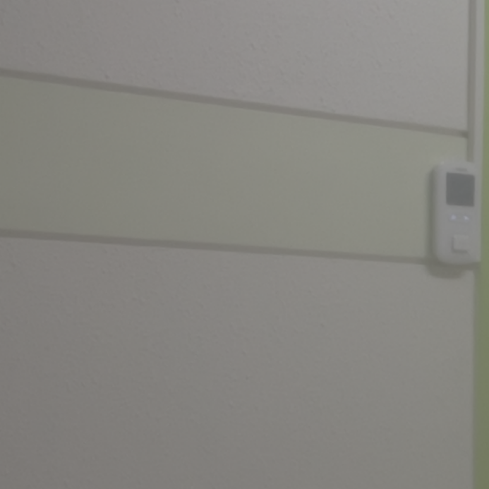

# MambaIR-Scratch

스마트폰 렌즈의 스크래치 때문에 흐려진 사진을 복원하는 모델입니다. 2026년 1학기 수업 프로젝트로 진행했고, 결과를 CVPR 양식의 논문으로 정리했습니다. 학회에 제출한 논문은 아닙니다.

- 논문: [paper/MambaIR-Scratch.pdf](paper/MambaIR-Scratch.pdf)
- 포스터: [paper/poster.pdf](paper/poster.pdf)
- 발표자료: [paper/slides.pdf](paper/slides.pdf)



## 문제

렌즈 스크래치는 한 방향으로 길게 이어지는 선 모양입니다. NAFNet 같은 CNN 모델은 3×3 컨볼루션으로 모든 방향을 똑같이 다루기 때문에 이런 패턴을 배우기에 비효율적이고, 수용 영역이 좁아서 긴 스크래치 전체를 한 번에 보지 못합니다.

## 방법

긴 시퀀스를 선형 복잡도로 처리하는 MambaIR(Selective State Space Model)을 백본으로 쓰고, 스크래치에 맞춘 모듈 세 개를 더했습니다.

| 모듈 | 하는 일 |
|---|---|
| DirectionalConv | 1×7과 7×1 depthwise 컨볼루션을 학습 가능한 가중치로 합쳐 수평·수직 방향성을 배움 |
| ScratchMaskAttn | 손상 강도 맵을 추정해 깨끗한 영역과 스크래치 영역을 나눠 처리 |
| ScratchLoss | Charbonnier, Edge, SSIM 손실을 가중 결합해 스크래치 경계를 선명하게 함 |

## 결과

SIDL 벤치마크의 Scratch 도메인에서 측정한 PSNR(dB)입니다.

| 모델 | Easy | Medium | Hard | 평균 |
|---|---|---|---|---|
| NAFNet | 27.55 | 25.16 | 20.24 | 24.32 |
| MambaIR | 28.78 | 26.40 | 22.51 | 25.90 |
| MambaIR-Scratch V3 | 27.47 | 24.92 | 20.02 | 24.14 |

V3의 평균 SSIM은 0.8621이고, 파라미터는 1.189M, 연산량은 41.37 GMACs입니다.

제안 모델은 두 베이스라인을 넘지 못했습니다. V2에서 V3로 가면서 평균 PSNR이 0.75 dB 올랐지만(23.39 → 24.14), Hard 난이도에서는 MambaIR보다 약 2.49 dB 낮습니다. 논문 5.2절에서 원인을 네 가지로 분석했습니다.

1. 7픽셀 커널로는 200픽셀이 넘는 스크래치 전체를 한 번에 보지 못함
2. 채널 96개로는 교차하거나 굵은 스크래치를 분리하기에 표현력이 부족함
3. 96×96 패치로 학습하고 전체 이미지로 추론해서 분포가 어긋남
4. 긴 스크래치의 양 끝이 다른 패치로 갈라지면 연속성을 잡기 어려움

## 시행착오

**FFT 손실 발산.** V3 초기 학습에서 FFT 손실 가중치를 0.1로 두었더니 500 iteration 만에 손실이 발산했습니다. 학습률을 낮추고, FFT 가중치를 0.0001까지 줄이고, 패치 크기를 줄여도 발산이 계속됐습니다. BasicSR의 `sr_model.py`를 직접 고쳐 gradient clipping(max_norm=1.0)을 넣고 warmup 5,000 iteration을 준 뒤에야 해결됐습니다.

**평가 수치의 거품.** 학습 중에 직접 잰 PSNR이 리더보드 결과와 크게 달랐습니다(Hard에서 5.95 dB 차이). 추적해 보니 평가 설정에서 정답 폴더와 입력 폴더를 같은 곳으로 잘못 지정해, 입력끼리 PSNR을 계산하고 있었습니다. 그 뒤로는 리더보드 제출 결과만 기준으로 삼았습니다.

자세한 내용은 논문 6절에 있습니다.

## 폴더

```
paper/       논문, 포스터, 발표자료
src/         mambair_scratch_arch.py (모델), scratch_losses.py (손실 함수)
options/     BasicSR 학습·평가 설정 (V2, V3)
notebooks/   Colab 학습 노트북 (V2, V3)
figures/     논문에 쓴 그림
```

## 실행 환경

NVIDIA A100 80GB(Google Colab Pro), PyTorch, BasicSR 기준입니다. `src/`의 두 파일을 MambaIR 저장소의 `basicsr/archs/`와 `basicsr/losses/`에 넣고 `options/`의 설정으로 학습합니다. 데이터셋과 학습된 가중치는 이 저장소에 없습니다.

## 기반 코드와 데이터

- [MambaIR](https://github.com/csguoh/MambaIR)
- [NAFNet](https://github.com/megvii-research/NAFNet)
- [BasicSR](https://github.com/XPixelGroup/BasicSR)
- SIDL: Smartphone Image with Dirty Lens (AAAI 2025)
